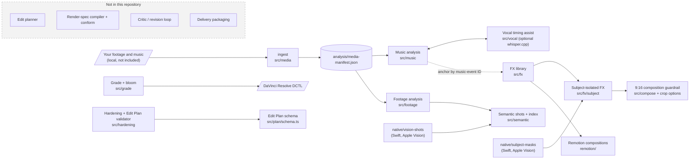

# Bali Music Editor

Bali Music Editor is an AI-assisted toolkit for making short-form music videos. It analyses a
song and a pool of longer-form footage, finds usable moments, and helps build edits that land on
the music. A person stays in charge of every creative choice; the software measures, proposes
and checks.

**Intended use.** Helping artists and label marketing teams turn longer-form footage (live sets,
studio sessions, behind-the-scenes and phone footage) into vertical, music-synchronised clips for
short-form platforms.

> **Status: sanitized code sample.** This public repository contains the reusable components of
> a larger private project. It does **not** include the complete end-to-end planner and rendering
> pipeline (edit planner, render-spec compiler, critic/revision loop, delivery packaging), or any
> project data such as media, analysis records or edit plans. The example videos below show the
> broader project workflow and can't be reproduced from this repository alone.

## How the example videos were made

- **Edit and grade:** Claude Code, connected to DaVinci Resolve through its MCP integration, helped
  edit and colour grade footage from longer-form clips and align the edits to the music.
- **Lyrics and hooks:** added afterward in CapCut for a more platform-native feel.
- **Lyric overlays in the broader editor:** the broader Bali Music Editor can also add lyric
  overlays. Lyric-overlay rendering is **not** included in this public snapshot.

## Example videos

Three short vertical edits (1080×1920, HEVC .mov, 60 fps, 15–23 s) made with this workflow from longer-form footage:

- [Concert and fireworks edit](examples/concert-fireworks-edit.mov)
- [Studio-to-concert edit](examples/studio-to-concert-edit.mov)
- [Artist-led VW bus edit](examples/artist-vw-bus-edit.mov)

HEVC .mov files may not play inline in every browser. Use **View raw** or download the file to watch it.

### Project note for reviewers

> These videos are examples created with the Bali Music Editor from longer-form footage. Claude Code, connected to DaVinci Resolve through its MCP integration, helped edit and color grade the footage and align the edits to the music. I added lyric and hook overlays in CapCut afterward for a more platform-native finish; lyric overlays can also be added within the editor. The public repository is a sanitized code sample of reusable components and does not include the complete end-to-end planner and rendering pipeline.

## Public code vs. the broader project

What the code in this repository provides, and what stays in the broader private project. The
example workflow is described above.

| Capability | Public code (this repo) | Not in this repo |
|---|---|---|
| Music analysis (tempo, beats, structure, drops, vocal attacks) | Yes | — |
| Visual analysis (shots, motion, sharpness, on-device faces / people / saliency) | Yes | — |
| Finding useful moments | Analysis and ranking signals (per-shot metrics, novelty / duplicate index) | Automatic shot selection (edit planner) |
| Music-synchronised editing | Effects anchored to music events with frame-exact snapping | Cut planner, render-spec compiler, timeline conform |
| Vertical (9:16) reframing | Subject guardrail, bounded reframe proposals, crop options | Applying crops in a finished render |
| Colour grading | CDL shot statistics and matching solver; highlight bloom with a DaVinci Resolve DCTL | Resolve project automation |
| Creative variations | Effect presets at several intensities, `CLEAN_TO_CHAOS`, subject-isolated stutter | Multi-candidate edit generation, critic / revision loop |
| Lyric and hook overlays | No | Lyric-overlay rendering (broader editor); the examples used CapCut |

## Architecture of the public snapshot

Arrows are verified imports, tool calls or data flows in this repository. The greyed box lists
stages of the broader project that are **not** included here.



## How to reproduce

**What a reviewer can run with this repository.** All commands are package scripts. First run
the [Setup](#setup) steps (`npm ci`, `doctor`, `config/sources.local.json`, `ingest`), then:

```bash
npm run typecheck && npm test && npm run test:acceptance   # no media needed

# Analyse your own media (media IDs are listed by `npm run ingest`)
npm run analyze-footage -- --all                 # -> analysis/footage/
npm run contact-sheet -- --media <videoMediaId>  # -> cache/frames/

# Music analysis needs a small project config naming the track's media ID:
#   projects/<name>/music-analysis.config.json  ->  {"schemaVersion": 1, "mediaId": "<audioMediaId>"}
npm run analyze-music -- --project projects/<name>/music-analysis.config.json   # -> analysis/music/
```

Optional, with extra local setup:
- `npm run build:vision` then `npm run analyze-semantics -- --all`: macOS with Xcode command-line tools.
- `npm run transcribe-vocals -- --project …`: a local whisper.cpp build and model, plus a
  `vocalAssist` block in the project config.

**Needs data that is not in this repository:** `npm run style` (private style memory) and the
Resolve MCP wiring (`.mcp.json`).

**Why the example videos can't be reproduced end to end here:**
- the source footage and music aren't included
- the planner and renderer stages that turn analysis into a cut aren't part of this snapshot
- the examples were edited and graded in DaVinci Resolve, with lyric overlays added in CapCut

## Module reference

| Area | What it does | Code |
|---|---|---|
| **Media foundation** | Ingests configured source folders into a deterministic `media-manifest.json`. Uses ffprobe normalisation for rotation, display size, VFR detection and stream selection, content fingerprints, frame decoding and contact sheets. | `src/media`, `npm run ingest`, `npm run contact-sheet` |
| **Music analysis** | DSP features, tempo, beat and downbeat grid, meter, loudness, and structure (breaks, builds, drops, impacts, phrase boundaries, sections). Also detects vocal-band attacks without speech recognition. User-authored sync events and overrides are resolved into one event set, with diagnostics. | `src/music`, `npm run analyze-music` |
| **Vocal timing assist (optional)** | Runs a local whisper.cpp pass for word timing, then flags hallucinations, repetition loops and window edges. Resolves human-declared vocal occurrences (primary attack plus effect repeats). | `src/vocal`, `npm run transcribe-vocals` |
| **Footage analysis** | Objective per-shot metrics: shot boundaries, motion, sharpness, exposure and duplicates. Cached by content fingerprint and analyser version. | `src/footage`, `npm run analyze-footage` |
| **Semantic shots (macOS)** | On-device Apple Vision analysis of sampled frames (faces, people, body pose, image labels, saliency, text regions, feature prints), plus a cross-media index of novelty, duplicates and continuity candidates. No network, no downloaded models. | `src/semantic`, `native/vision-shots`, `npm run analyze-semantics` |
| **FX library** | A deterministic effect contract, anchored to music events and cut-safe. It includes the `CLEAN_TO_CHAOS` escalation preset and a subject-isolated temporal stutter: on-device person masks plus mask QC and eligibility gates. | `src/fx`, `native/subject-masks` |
| **Composition** | A 9:16 human-subject guardrail: dominant-subject tracking, bounded reframe proposals, and dead-band and lead-room rules. Crop options seeded from a human-chosen point. | `src/compose`, `src/render/crop-options.ts` |
| **Grade** | ASC CDL shot statistics with a restrained matching solver, and a highlight-selective bloom that generates a DaVinci Resolve DCTL plus a bit-matched offline twin. | `src/grade` |
| **Hardening** | Atomic writes, a disk-headroom policy, exact frame-timing, audio-sync, colour-tag and orientation checks, and an Edit Plan validator with coded issues. | `src/hardening` |
| **Style memory** | A preference engine with scoping rules: one project's taste never leaks into another, and general preferences need explicit statements or repeated evidence. | `src/style`, `npm run style` |
| **Renderer layer** | Remotion compositions (clean-edit playback and effects) and a render driver, making no creative decisions. Their inputs (conformed clips and render props) come from the excluded planner/conform stage, so they don't render a finished edit on their own. | `remotion/` |
| **Environment check** | `npm run doctor`: a read-only report of tools, codecs, disk and optional integrations. | `src/cli/doctor.ts` |

All records are validated with zod. `schemas/` holds the exported JSON Schemas; regenerate them
with `npm run schema:export`.

## Requirements

- macOS (Apple silicon tested). The Swift/Vision helpers are macOS-only; everything else is portable
  TypeScript.
- **Node.js ≥ 24.** The code runs as TypeScript directly via Node's type stripping, with no build step.
- **FFmpeg / ffprobe** on `PATH`, for media work and the acceptance tests.
- Optional:
  - Xcode command-line tools (`swiftc`), for `npm run build:vision` and `npm run build:subject-masks`
  - a local whisper.cpp build and model, for the vocal assist
  - DaVinci Resolve, for the DCTL / finishing path

## Setup

```bash
npm ci
npm run doctor                      # read-only environment report
cp config/sources.example.json config/sources.local.json
# edit config/sources.local.json: point each source root at your own footage / music folders
npm run ingest                      # -> analysis/media-manifest.json
```

Per-project configuration lives in `projects/<name>/` (not included). For example,
`projects/<name>/music-analysis.config.json` points the music CLIs at a local track and section
window. Media, analysis output, caches and renders are written to git-ignored folders
(`analysis/`, `cache/`, `projects/`, `renders/`).

To run the Remotion layer: `cd remotion && npm ci && npm run typecheck` (or `npm run studio`).

### Local configuration (placeholders, never committed)

| File | Purpose |
|---|---|
| `config/sources.local.json` | Your source roots (copy from `config/sources.example.json`) |
| `projects/<name>/music-analysis.config.json` | Track path and section window for the music CLIs |
| `style/bali/memory.json` + decision logs | Style memory used by `npm run style` (private; not included) |
| `.mcp.json` | Optional DaVinci Resolve MCP server wiring (machine-specific; not included) |
| `config/resolve-mcp/preferences.json` | Included. Resolve-MCP safety defaults (safe mode, confirmation tokens, audit logs); the log paths are relative placeholders |

## Tests

```bash
npm run typecheck          # tsc --noEmit
npm test                   # unit tests (pure, no media, no FFmpeg)
npm run test:acceptance    # synthetic acceptance tests (FFmpeg generates its own test media)
npm run test:fast          # all of the above
```

What the tests cover, and what they need:

- **Unit tests** (`tests/unit`): self-contained.
- **Acceptance tests** (`tests/acceptance`): generate synthetic media with FFmpeg into git-ignored
  temp folders.
- **`doctor.test.ts`**:
  - must run inside a git checkout (it asserts the doctor leaves the working tree unchanged)
  - checks that the committed Resolve-MCP safety preferences are on
  - the doctor itself reports BLOCKING when free disk is below the media floor in
    `config/resource-policy.json` (30 GiB); the test accepts that, it only checks that the exit code
    matches
- **Not included:** tests that need private project data (real footage, approved plans, golden
  renders, style memory or a local Resolve installation). They exist only in the private repository.

## Known limitations

- **Pipeline:** this snapshot stops at analysis, effects, composition and validation. The planner,
  render-spec compiler, critic loop and delivery packaging aren't included, so there is no
  end-to-end "song + footage → finished video" command here.
- **Semantic analysis and masks:** these depend on Apple Vision and only run on macOS.
- **Heuristics:** music structure labels and vocal-attack detection are heuristic. They report
  confidence and omit labels when evidence is weak, and human overrides are part of the design.
- **Vocal assist:** whisper.cpp is optional and treated as evidence only. It never moves or deletes
  a sync point.
- **Status:** internal tool, no stable public API. Interfaces may change.

## Built with

- TypeScript on Node.js (≥ 24, native type stripping) with [zod](https://zod.dev) schemas
- FFmpeg / ffprobe for decoding, probing and test-media generation
- Swift with Apple Vision (on-device semantic analysis and person masks)
- [Remotion](https://www.remotion.dev) and React for the renderer layer
- whisper.cpp (optional, local vocal timing assist)
- DaVinci Resolve: DCTL generation, plus a read-only check of the Resolve MCP setup in `npm run doctor`
- Claude Code (development and the editing workflow described above)

## License

No licence is granted. This repository is shared for review only; all rights reserved.
